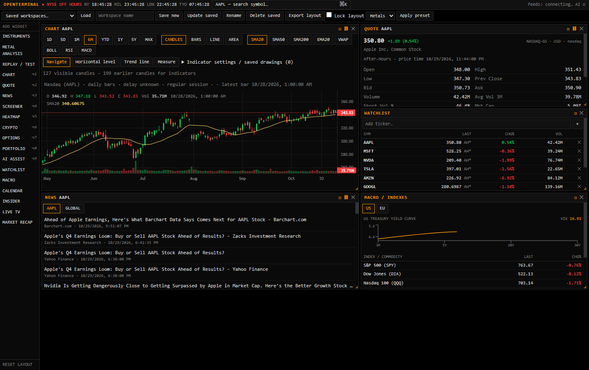

OpenTerminal Desktop is a Windows app for market charts, news, saved workspaces and local portfolio records.


<p align="center">
  
</p>

<h1 align="center">OpenTerminal Desktop</h1>

<p align="center">
  <strong>English</strong> · <a href="README.tr.md">Türkçe</a><br />
  <a href="desktop/README.md"><strong>Build the Windows app</strong></a> ·
  <a href="#start-with-the-source">Run in a browser</a> ·
  <a href="https://github.com/ErTasselli/OpenTerminal">Original project</a>
</p>

It extends [ErTasselli/OpenTerminal](https://github.com/ErTasselli/OpenTerminal), which provides the terminal interface, market-data adapters and core widgets. This edition adds the Electron desktop shell, packaging and workspace changes listed below. [UPSTREAM.md](UPSTREAM.md) records the source revision and file-level differences. Market labels are in English and desktop menus are in Turkish.

## Start with the source

This repository contains source and build instructions; installers are not included.

| Requirement | Setup |
| --- | --- |
| Browser development | Node.js, npm and an internet connection for dependencies and market feeds |
| Windows desktop build | Windows x64, the recipe's pinned Node.js **26.13.0**, and Python 3 |
| Stack | Next.js 15, React 19, Express, TypeScript and SQLite; Electron for the desktop shell |
| Optional AI | An Anthropic-compatible service configured with your own credentials |

```sh
git clone https://github.com/ArdaHFO/openterminal-desktop.git
cd openterminal-desktop
npm ci
npm run dev
```

Open `http://localhost:3000`. API status is available at `http://127.0.0.1:4000/api/status`. The checked-in browser CI configuration uses Node.js 22; the desktop staging script explicitly requires its separate pinned runtime.

For the installed Windows experience, follow the [desktop build guide](desktop/README.md). It produces a per-user NSIS installer under `outputs/desktop-package/`. The installed package bundles its own runtime and services. Building it requires development tools; using a completed package does not require a source checkout or system Node/npm.

The local API generates a shared secret on first browser-mode startup and stores it in `data/.api-key`. Keep that file private. AI is optional. `ANTHROPIC_API_KEY`, `ANTHROPIC_BASE_URL` and `ANTHROPIC_MODEL` are read from the process environment; do not commit their values.

## What this edition adds

| Area | Additions beyond the pinned upstream source |
| --- | --- |
| Windows desktop | Electron window, tray controls, owned loopback services, bundled runtime and NSIS packaging |
| Saved workspaces | Named snapshots, presets, layout lock, maximize/restore and JSON export/import |
| Charts | Persistent levels, trend lines and measurements, configurable indicator periods, revised range/history handling |
| Instruments and metals | Shared symbol catalogue, aliases, spot/futures distinctions, timestamp-aware comparisons and derived metal series |
| Historical replay | Candle-by-candle playback and a long-only moving-average simulation with configurable fees and slippage |
| Portfolio handling | Canonical symbols, input validation, oversell checks and desktop SQLite backup/restore |
| Widget behavior | Explicit empty/error states, symbol unlinking, scoped options expiry and more robust TV playback handling |
| Verification sources | Additional provider/math tests, synthetic browser scenarios, and desktop policy/service/lifecycle checks |

See the [implementation notes](docs/analysis-workspace-package.md) for details and constraints.

## Workspace preview

<p align="center">
  
</p>

Desktop development screenshot from **29 October 2026**, showing data from that session. Other images in `docs/screenshots/` come from the upstream project.

## Use the workspace

1. Search for a symbol with the top bar or command palette, then add the panels you need.
2. Save a named workspace. Presets can arrange panels for different markets, and layout lock keeps their positions fixed.
3. Use chart controls for ranges, indicators and drawing tools. Drawings are stored by canonical symbol.
4. Use Replay to reveal historical candles progressively. Its simulation is separate from live quote widgets and does not place orders.
5. Record portfolio transactions locally. In the Windows app, the **Yedekleme** menu exports/imports layouts and portfolio backups.

Browser data and desktop data are separate. The installed app keeps its data under `%LOCALAPPDATA%\OpenTerminal Desktop`, outside the program directory. Importing a browser layout does not transfer credentials or portfolio data. Read the [migration instructions](desktop/README.md#backups-and-migration) before moving existing records.

## Development

The repository keeps the original npm workspace structure. These commands are available for development and verification:

```sh
npm test
npm run build
npm run test:e2e
node --test desktop/policy.test.cjs
```

Browser scenarios use synthetic API fixtures and isolated test output. Local Playwright configuration selects Microsoft Edge; CI selects Playwright Chromium. Desktop service checks require a prepared desktop stage, and installer checks intentionally exercise Windows installation state. Follow the [desktop guide](desktop/README.md) for those prerequisites.

Build output and test reports go under the ignored `outputs/` and `test-artifacts/` directories.

## Limitations

- Market data uses public external endpoints. Availability, latency, precision and terms are provider-dependent; quotes can be delayed or incomplete.
- The Windows package is unsigned and has no automatic update service. Updates require a newly built installer.
- Replay is a simplified, long-only simulation. It does not model every trading cost, futures multiplier, corporate action or execution condition.
- The portfolio is a local ledger. The application does not connect to a brokerage to place orders.
- TV availability and subscriptions are controlled by broadcasters. A channel link is not a guarantee of a free stream.
- The default local API is not a hosted multi-user service. Review authentication, origins and transport security before changing its network exposure.

## Project map

```text
desktop/    Electron shell, packaging, backup policy and desktop checks
launcher/   Older Windows helper for the browser development installation
web/        Next.js interface, widgets, drawings and workspace state
server/     Express API, provider adapters, portfolio ledger and tests
catalog/    Shared instrument identifiers, aliases and capabilities
tests/      Browser scenarios and fixtures
docs/       Implementation notes and attributed screenshots
data/       Placeholder for local runtime data; private contents are ignored
```

## Contributing

Report desktop-edition problems through [issues](https://github.com/ArdaHFO/openterminal-desktop/issues), with the affected workflow and steps to reproduce. Use sample data for portfolio, backup or migration changes. Keep account data, credentials and installer bundles out of source contributions.

## License and upstream credits

[MIT License](LICENSE). The original **Copyright (c) 2026 OpenTerminal contributors** notice is unchanged.

Based on [ErTasselli/OpenTerminal](https://github.com/ErTasselli/OpenTerminal) at [`aed097c680cd8ec1c391ae06966babe7d6d91fc6`](https://github.com/ErTasselli/OpenTerminal/commit/aed097c680cd8ec1c391ae06966babe7d6d91fc6). This is an independent desktop extension, not an official upstream release. [UPSTREAM.md](UPSTREAM.md) lists the changes and image credits. External data, media and dependencies retain their own terms and notices.
