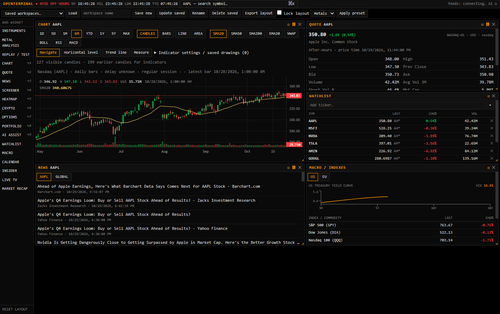

OpenTerminal Desktop, piyasa grafiklerini, haberleri ve kişisel portföyünü tek bir Windows uygulamasında bir araya getirir.

<p align="center">
  
</p>

<h1 align="center">OpenTerminal Desktop</h1>

<p align="center"><strong>Piyasaların. Düzenin. Masaüstün.</strong></p>
<p align="center">Kayıtlı çalışma alanları, grafik çizimleri, geçmiş piyasa oynatımı ve yerel portföy yedekleri sunan OpenTerminal Windows masaüstü sürümü.</p>

<p align="center">
  <a href="README.md">English</a> · <strong>Türkçe</strong><br />
  <a href="desktop/README.md"><strong>Windows uygulamasını derle</strong></a> ·
  <a href="#kaynaktan-başla">Tarayıcıda çalıştır</a> ·
  <a href="https://github.com/ErTasselli/OpenTerminal">Özgün proje</a>
</p>

---

Grafik, fiyat, haber ve analiz panellerini piyasayı takip etme biçimine göre düzenle. Hisse, metal veya kripto için ayrı çalışma alanları kaydet, grafiklere çizim ekle, geçmiş mumları incele ve portföy işlemlerini yerel olarak tut.

**Bu sürüm, [ErTasselli/OpenTerminal](https://github.com/ErTasselli/OpenTerminal) üzerine geliştirilmiştir.** Terminal arayüzü, piyasa verisi sağlayıcıları ve temel paneller özgün projeden gelir. Bu repo bağımsız Windows masaüstü katmanını ve aşağıdaki iş akışı geliştirmelerini ekler. Özgün MIT lisansı ve katkıcıların telif bildirimi korunur. Kesin kaynak sürümü ve dosya bazında karşılaştırma için [UPSTREAM.md](UPSTREAM.md) belgesine bak.

Bu repo kaynak kodu ve derleme yönergelerini içerir. Derlenmiş kurucular, bağımlılıklar, özel ayarlar, portföy veritabanları ve yerel test kayıtları dahil edilmez. Arayüzde İngilizce piyasa etiketleri ile Türkçe masaüstü menüleri birlikte kullanılır. İki README aynı sürümü anlatır.

## Kaynaktan başla

| Gereksinim | Kurulum |
| --- | --- |
| Tarayıcıda geliştirme | Node.js, npm ve bağımlılıklar/piyasa akışları için internet |
| Windows masaüstü derlemesi | Windows x64, tarifte sabitlenen **Node.js 26.13.0** ve Python 3 |
| Yapı | Next.js 15, React 19, Express, TypeScript ve SQLite; masaüstü için Electron |
| İsteğe bağlı yapay zekâ | Kendi erişim bilgilerinle yapılandırılan Anthropic uyumlu hizmet |

```sh
git clone https://github.com/ArdaHFO/openterminal-desktop.git
cd openterminal-desktop
npm ci
npm run dev
```

`http://localhost:3000` adresini aç. API durumu `http://127.0.0.1:4000/api/status` adresindedir. Repodaki tarayıcı CI yapılandırması Node.js 22 kullanır. Masaüstü hazırlama betiği ayrı olarak sabitlenmiş sürümünü zorunlu tutar.

Kurulan Windows uygulaması için [masaüstü derleme rehberini](desktop/README.md) izle. Kullanıcı bazlı NSIS kurucusu `outputs/desktop-package/` altında oluşur. Kurulan paket kendi çalışma ortamını ve servislerini içerir. Derlemek için geliştirme araçları gerekir; tamamlanmış paketi kullanmak için kaynak checkout'u veya sistemde Node/npm gerekmez.

Yerel API, tarayıcı kipindeki ilk açılışta ortak erişim anahtarı oluşturur ve `data/.api-key` dosyasında saklar. Bu dosyayı özel tut. Yapay zekâ isteğe bağlıdır. `ANTHROPIC_API_KEY`, `ANTHROPIC_BASE_URL` ve `ANTHROPIC_MODEL` süreç ortamından okunur; değerlerini commit etme.

## Bu sürümün ekledikleri

| Alan | Sabitlenen özgün kaynağa eklenenler |
| --- | --- |
| Windows masaüstü | Electron penceresi, sistem tepsisi, yönettiği yerel servisler, paketlenmiş çalışma ortamı ve NSIS kurucusu |
| Kayıtlı çalışma alanları | Adlandırılmış anlık düzenler, hazır düzenler, kilit, büyüt/geri al ve JSON dışa/içe aktarma |
| Grafikler | Kalıcı seviyeler, trend çizgileri ve ölçümler, ayarlanabilir indikatör dönemleri, yenilenen aralık/geçmiş işleme |
| Enstrümanlar ve metaller | Ortak sembol kataloğu, alternatif adlar, spot/vadeli ayrımı, zaman uyumlu karşılaştırmalar ve türetilmiş metal serileri |
| Geçmişi oynatma | Mumları adım adım gösterme ve ücret/kayma ayarları olan, yalnız uzun pozisyon açan hareketli ortalama simülasyonu |
| Portföy işlemleri | Ortak sembol biçimi, girdi doğrulama, eldeki miktarı aşan satış kontrolü ve masaüstünde SQLite yedekleme/geri yükleme |
| Panel davranışları | Açık boş/hata durumları, sembol bağlantısını ayırma, sembole bağlı opsiyon vadesi ve TV oynatma hata yönetimi |
| Doğrulama kaynakları | Ek sağlayıcı/matematik testleri, sentetik tarayıcı senaryoları ve masaüstü politika/servis/yaşam döngüsü kontrolleri |

Bu eklemeler kaynak kodda bulunur. Varlıkları, testlerin bu yayın için yeniden çalıştırıldığı anlamına gelmez. Davranış ve sınırlar [uygulama notlarında](docs/analysis-workspace-package.md) açıklanır.

## Çalışma alanı önizlemesi

<p align="center">
  
</p>

**29 Ekim 2026** tarihli mevcut masaüstü geliştirme görüntüsü, üzerinde görsel düzenleme yapılmadan yeniden kullanıldı. Önceki oturumu gösterir; yeni açılış veya güncel sağlayıcı erişimi doğrulaması değildir. `docs/screenshots/` içindeki diğer görüntüler özgün projeden gelir.

## Çalışma alanını kullan

1. Üst çubuktan veya komut paletinden sembol ara ve gereken panelleri ekle.
2. Çalışma alanını adlandırarak kaydet. Hazır düzenler farklı piyasalara göre panel yerleştirir; düzen kilidi konumları sabit tutar.
3. Grafik aralığını, indikatörleri ve çizim araçlarını kullan. Çizimler ortak sembol kimliğine göre saklanır.
4. Replay ile geçmiş mumları sırayla göster. Simülasyonu canlı fiyat panellerinden ayrıdır ve emir göndermez.
5. Portföy işlemlerini yerel olarak kaydet. Windows uygulamasının **Yedekleme** menüsünden düzen ve portföy yedeği dışa/içe aktar.

Tarayıcı ve masaüstü verileri ayrıdır. Kurulan uygulama verilerini program klasörü dışında, `%LOCALAPPDATA%\OpenTerminal Desktop` altında tutar. Tarayıcı düzenini içe aktarmak erişim anahtarlarını veya portföyü taşımaz. Mevcut kayıtları taşımadan önce [aktarma yönergelerini](desktop/README.md#backups-and-migration) oku.

## Geliştirme

Repo özgün npm workspace yapısını korur. Geliştirme ve doğrulama için şu komutlar bulunur:

```sh
npm test
npm run build
npm run test:e2e
node --test desktop/policy.test.cjs
```

Tarayıcı senaryoları sentetik API yanıtları ve ayrı test çıktıları kullanır. Yerel Playwright ayarı Microsoft Edge'i, CI ise Playwright Chromium'u seçer. Masaüstü servis kontrolleri hazırlanmış paket alanı gerektirir. Kurucu kontrolleri Windows kurulum durumunu özellikle değiştirir. Önkoşullar için [masaüstü rehberini](desktop/README.md) izle.

Derlemeler ve kayıtlar, Git tarafından dışlanan `outputs/` ve `test-artifacts/` klasörlerine yazılır. Yayın hazırlığında masaüstü çıktı yolları bu klonun içinde kalacak şekilde düzenlendi. Bu kaynak yayını için test paketi, derleme veya kurucu doğrulaması çalıştırılmadı. Yeni bir uygulama ekran görüntüsü ya da çalışma zamanı doğrulaması tamamlanmadı.

## Doğrulama ve mevcut sınırlar

- Yayın kontrolleri kaynak kökenini, izole dosya envanterini, belge bağlantılarını ve yerel veri/erişim bilgilerinin dışlanmasını kapsar. Önceki doğrulama oturumları yeni test sonucu olarak sunulmaz.
- Piyasa verisi dış sağlayıcıların herkese açık uç noktalarından gelir. Erişim, gecikme, doğruluk ve kullanım koşulları sağlayıcıya bağlıdır; fiyatlar gecikmeli veya eksik olabilir.
- Windows paketi imzasızdır ve otomatik güncelleme servisi yoktur. Güncelleme yeni bir kurucu oluşturmayı gerektirir.
- Replay basitleştirilmiş, yalnız uzun pozisyon kullanan bir simülasyondur. Her maliyeti, vadeli sözleşme çarpanını, şirket işlemini veya gerçekleşme koşulunu modellemez.
- Portföy yerel bir işlem defteridir. Uygulama emir göndermek için aracı kuruma bağlanmaz.
- TV erişimi ve abonelikler yayıncıların kontrolündedir. Kanal bağlantısı ücretsiz yayın garantisi değildir.
- Varsayılan yerel API barındırılan çok kullanıcılı bir hizmet değildir. Ağ erişimini değiştirmeden önce kimlik doğrulama, origin ve aktarım güvenliğini incele.

## Proje yapısı

```text
desktop/    Electron katmanı, paketleme, yedekleme politikası ve kontroller
launcher/   Tarayıcı geliştirme kurulumu için önceki Windows yardımcısı
web/        Next.js arayüzü, paneller, çizimler ve çalışma alanı durumu
server/     Express API, sağlayıcılar, portföy defteri ve testler
catalog/    Ortak enstrüman kimlikleri, alternatif adlar ve yetenekler
tests/      Tarayıcı senaryoları ve örnek yanıtlar
docs/       Uygulama notları ve kaynağı belirtilen görüntüler
data/       Yerel çalışma verileri için yer tutucu; özel içerikler dışlanır
```

## Katkı

Değişikliği odaklı tut ve etkilenen akışı, sağlayıcı varsayımlarını ve yapılan doğrulamayı açıkla. Portföy, yedekleme veya aktarma kodunu değiştirirken ayrı örnek veriler kullan. Hesap verilerini, erişim anahtarlarını veya üretilmiş kurucu paketlerini kaynak katkısına ekleme.

Bu sürüme özgü sorunları [repo issue sayfasında](https://github.com/ArdaHFO/openterminal-desktop/issues) bildir. Özgün projeye gönderilecek değişikliklerde onun katkı sürecine de uy.

## Lisans ve özgün proje

[MIT Lisansı](LICENSE) ve özgün **Copyright (c) 2026 OpenTerminal contributors** bildirimi değiştirilmeden korunur.

Özgün proje **[ErTasselli/OpenTerminal](https://github.com/ErTasselli/OpenTerminal)**. Yerel geliştirme tabanı [`aed097c680cd8ec1c391ae06966babe7d6d91fc6`](https://github.com/ErTasselli/OpenTerminal/commit/aed097c680cd8ec1c391ae06966babe7d6d91fc6) commit'idir. Bu masaüstü sürümü bağımsız bir genişletmedir; resmî upstream sürümü veya veri sağlayıcısı onayı değildir. Atıf ve değişiklik kapsamı için [UPSTREAM.md](UPSTREAM.md) belgesine bak. Dış veri, medya ve paketlenen bağımlılıkların kendi koşulları ve bildirimleri geçerliliğini korur.
